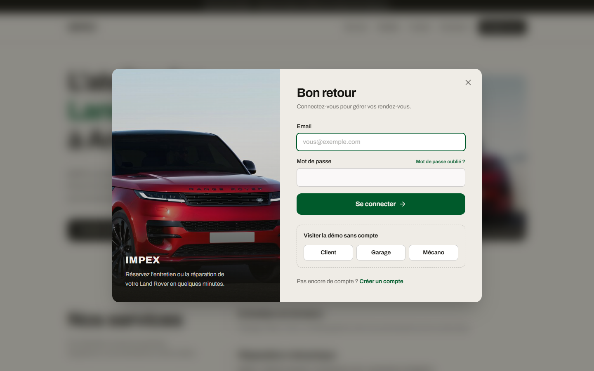
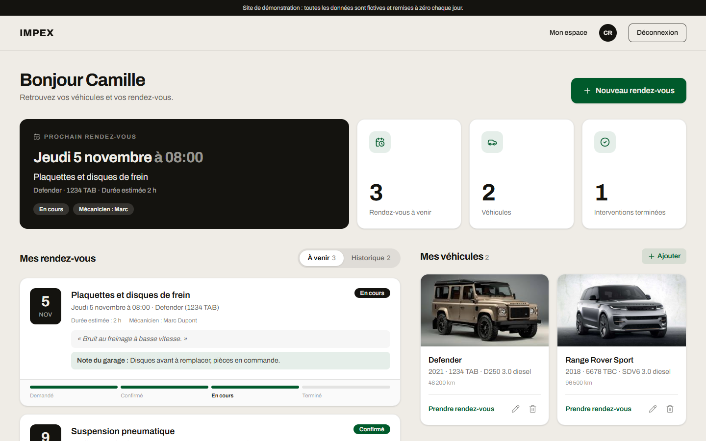
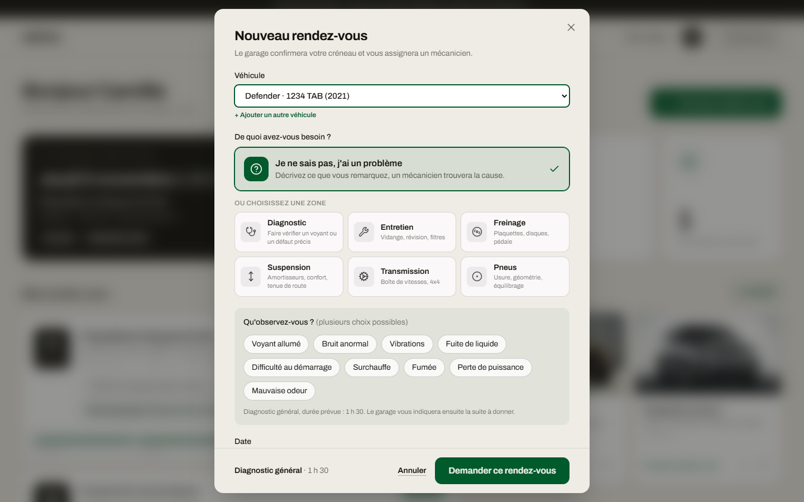
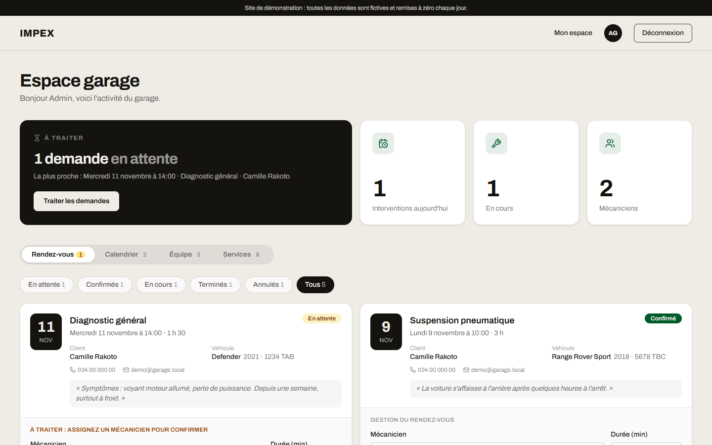
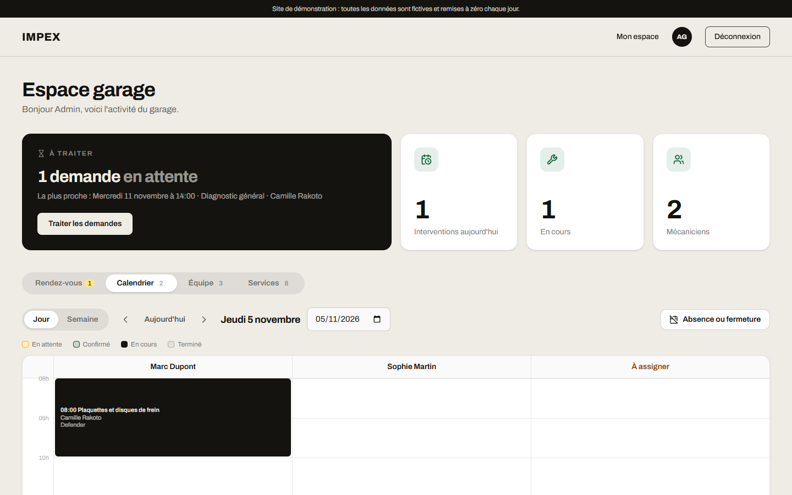
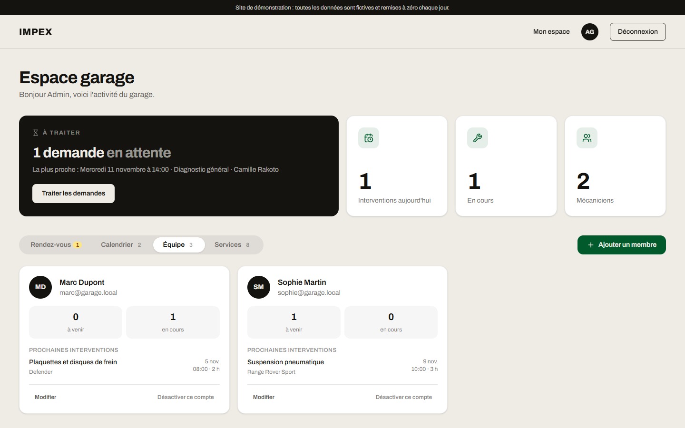
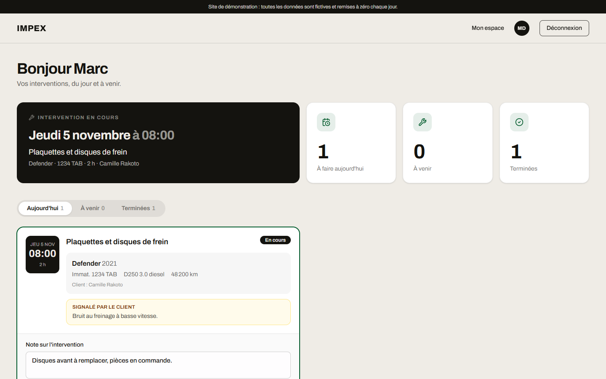

# IMPEX, rendez-vous pour garage Land Rover

Application web de prise de rendez-vous pour IMPEX, garage Land Rover et mécanique générale à Antananarivo.

Le client choisit une prestation pour son véhicule et une heure disponible. Le garage confirme, assigne un mécanicien et suit l'avancement jusqu'à la fin de l'intervention.

## Sommaire

- [Démo en ligne](#démo-en-ligne)
- [Technologies](#technologies)
- [Fonctionnalités](#fonctionnalités)
- [Démarrage](#démarrage)
- [Comptes de démonstration](#comptes-de-démonstration)
- [Structure](#structure)
- [Règles de gestion](#règles-de-gestion)
- [API](#api)
- [Configuration](#configuration)
- [Tests](#tests)
- [Sécurité](#sécurité)
- [Mode démo](#mode-démo)
- [Mise en ligne](#mise-en-ligne)
- [Lancer sans Docker](#lancer-sans-docker)
- [Voir la base avec Compass](#voir-la-base-avec-compass)
- [Reste à faire](#reste-à-faire)

## Démo en ligne

**https://impex-ivo5.vercel.app**

La fenêtre de connexion propose « Visiter la démo sans compte » avec trois accès : client, garage et mécano. Les données sont fictives et remises à zéro chaque jour. L'API tourne sur Vercel, la base sur MongoDB Atlas (offres gratuites).

| | |
| --- | --- |
|  |  |
| Page d'accueil | Connexion et accès démo |
|  |  |
| Espace client | Réservation guidée |
|  |  |
| Espace garage | Calendrier par mécanicien |
|  |  |
| Équipe | Espace mécanicien |

## Technologies

| Partie  | Outils                                      |
| ------- | ------------------------------------------- |
| Front   | Vue 3, Vite, Pinia, Vue Router, Tailwind 4  |
| Back    | Node.js, Express 5, Mongoose, JWT           |
| Base    | MongoDB 7                                   |
| Outils  | Docker Compose, pnpm, Mailpit               |

## Fonctionnalités

Trois rôles, chacun avec son espace.

| Rôle     | Ce qu'il fait                                          |
| -------- | ------------------------------------------------------ |
| `client` | Gère ses véhicules, prend et annule des rendez-vous    |
| `admin`  | Planifie, assigne, gère services, équipe et absences   |
| `mecano` | Voit ses interventions, les démarre, les termine       |

Côté client :
- ajout, modification et suppression de véhicules
- réservation guidée : zone du véhicule, ou « Je ne sais pas » avec les symptômes
- créneaux réellement libres, calculés selon la durée de la prestation
- suivi de l'avancement et notes du mécanicien

Côté admin :
- liste des demandes, assignation d'un mécanicien, durée estimée
- reprogrammation d'un rendez-vous
- calendrier par jour (un mécanicien par colonne) et par semaine
- absences des mécaniciens et fermetures du garage
- gestion des services et de l'équipe (ajout, modification, désactivation)

Pour tous les comptes : page « Mon compte », changement de mot de passe et mot de passe oublié par email.

## Démarrage

Docker Desktop doit être lancé.

```bash
docker compose up --build
```

Dans un second terminal, une seule fois, pour créer les comptes et services de démonstration :

```bash
docker compose exec backend pnpm seed
```

Le seed peut être relancé sans risque : il ajoute ce qui manque et ne touche pas aux données existantes.

| Service   | Adresse                          |
| --------- | -------------------------------- |
| Site      | http://localhost:5173            |
| API       | http://localhost:3000/api/health |
| MongoDB   | mongodb://localhost:27017        |
| Mailpit   | http://localhost:8025            |

Mailpit est une fausse boîte mail de développement. Il reçoit les emails de l'API (le lien « mot de passe oublié », par exemple) sans rien envoyer pour de vrai.

Au quotidien :

```bash
docker compose up -d
docker compose down
```

Le code est monté en volume : le front se recharge tout seul et le back redémarre avec nodemon. Un `--build` n'est utile que si un `Dockerfile` ou les dépendances changent :

```bash
docker compose up -d --build -V
```

Si un style manque après l'ajout d'un nouveau fichier du front, `docker compose restart frontend` suffit.

## Comptes de démonstration

Créés par le seed. Mot de passe : `Password123!` (variable `SEED_PASSWORD` pour le changer).

| Rôle   | Email                 |
| ------ | --------------------- |
| admin  | `admin@garage.local`  |
| mecano | `marc@garage.local`   |
| mecano | `sophie@garage.local` |

Ces comptes servent au développement uniquement. Les clients créent leur compte depuis le site.

## Structure

```
.
├── docker-compose.yml
├── Back-end/
│   ├── src/
│   │   ├── config/        base de données, horaires du garage
│   │   ├── controllers/   logique métier
│   │   ├── middlewares/   authentification, rôles, sécurité, erreurs
│   │   ├── models/        User, Vehicle, Service, Appointment, TimeOff
│   │   ├── routes/        routes de l'API
│   │   ├── scripts/       seed.js
│   │   ├── utils/         créneaux, heures du garage, emails
│   │   ├── app.js
│   │   └── server.js
│   ├── api/               point d'entrée Vercel
│   └── tests/             tests automatiques
└── frontend/
    ├── public/images/     photos des modèles
    └── src/
        ├── components/    fenêtres, cartes
        ├── data/          contenu de la page d'accueil
        ├── lib/           API, formats de dates, catégories
        ├── router/        routes et accès par rôle
        ├── stores/        Pinia (auth, ui)
        └── views/         une page par espace
```

### Données

- **User** : nom, email, mot de passe haché, téléphone, rôle, actif ou non
- **Vehicle** : propriétaire, modèle, année, plaque, VIN, motorisation, kilométrage
- **Service** : nom, zone, durée par défaut, actif ou non
- **TimeOff** : fermeture du garage ou absence d'un mécanicien, par jours entiers
- **Appointment** : client, véhicule, service, date, statut, mécanicien, durée, notes

Statuts d'un rendez-vous : `pending`, `confirmed`, `in_progress`, `done`, ou `cancelled`.

## Règles de gestion

Créneaux
- Un créneau est proposé si l'intervention finit avant la fermeture et si un mécanicien reste libre pendant toute sa durée.
- Les demandes en attente comptent déjà comme une place prise, pour ne pas promettre plus que le garage ne peut faire.
- Le serveur revérifie le créneau au moment de la réservation.
- Horaires, pas de 30 minutes, délai minimum d'une heure et fuseau (UTC+3) : `Back-end/src/config/garage.js`.

Absences et fermetures
- Un jour de fermeture n'est plus réservable et son motif est affiché au client.
- Un mécanicien absent n'est plus compté, et on ne peut pas lui assigner d'intervention.
- Les rendez-vous déjà pris sur la période ne sont pas annulés. L'admin reçoit la liste pour les réassigner ou les refuser.

Rendez-vous
- Assigner un mécanicien confirme le rendez-vous.
- L'assignation est refusée si le mécanicien a déjà une intervention qui chevauche le créneau.
- Un rendez-vous ne démarre pas sans mécanicien.
- Reprogrammer exige un créneau libre. Si le mécanicien assigné n'est pas disponible à la nouvelle date, il est retiré et le rendez-vous repasse en attente.
- Un client annule tant que le rendez-vous est en attente ou confirmé. Il ne peut pas supprimer un véhicule qui a un rendez-vous à venir.
- Un mécanicien ne voit que ses interventions et le nom du client. Il les fait avancer d'une étape à la fois et peut écrire une note.

Comptes
- Un compte désactivé ne peut plus se connecter, même avec une session ouverte. Son historique reste, et ses interventions à venir sont à réassigner.
- Changer ou réinitialiser son mot de passe ferme les autres sessions.
- Le lien « mot de passe oublié » dure une heure et ne sert qu'une fois. La réponse de l'API est la même que l'adresse existe ou non.

## API

Toutes les routes commencent par `/api`. Les routes protégées demandent l'en-tête `Authorization: Bearer <token>`.

| Méthode | Route                          | Accès               |
| ------- | ------------------------------ | ------------------- |
| GET     | `/health`                      | public              |
| POST    | `/auth/register`               | public              |
| POST    | `/auth/login`                  | public              |
| POST    | `/auth/forgot-password`        | public              |
| POST    | `/auth/reset-password`         | public              |
| GET     | `/auth/me`                     | connecté            |
| PATCH   | `/auth/me`                     | connecté            |
| PATCH   | `/auth/password`               | connecté            |
| GET     | `/services`                    | public              |
| GET     | `/services/all`                | admin               |
| POST    | `/services`                    | admin               |
| PATCH   | `/services/:id`                | admin               |
| GET     | `/availability`                | client, admin       |
| GET     | `/garage`                      | public              |
| GET     | `/timeoff`                     | admin               |
| POST    | `/timeoff`                     | admin               |
| DELETE  | `/timeoff/:id`                 | admin               |
| GET     | `/vehicles/models`             | client              |
| GET     | `/vehicles`                    | client              |
| POST    | `/vehicles`                    | client              |
| PATCH   | `/vehicles/:id`                | client              |
| DELETE  | `/vehicles/:id`                | client              |
| GET     | `/appointments`                | selon le rôle       |
| POST    | `/appointments`                | client              |
| PATCH   | `/appointments/:id/assign`     | admin               |
| PATCH   | `/appointments/:id/reschedule` | admin               |
| PATCH   | `/appointments/:id/status`     | admin, mécano, client |
| PATCH   | `/appointments/:id/notes`      | admin, mécano       |
| GET     | `/users/mechanics`             | admin               |
| GET     | `/users/staff`                 | admin               |
| POST    | `/users/staff`                 | admin               |
| PATCH   | `/users/staff/:id`             | admin               |
| PATCH   | `/users/staff/:id/active`      | admin               |

Précisions :
- `/auth/register` crée toujours un client.
- `/auth/me` : le changement d'email demande le mot de passe actuel.
- `/availability?date=AAAA-MM-JJ&serviceId=...` renvoie les créneaux du jour. Si le jour est complet ou fermé, il propose le prochain créneau libre. L'admin peut passer `appointmentId` à la place de `serviceId`, pour reprogrammer.
- `/appointments` : le client voit les siens, le mécano ceux qui lui sont assignés, l'admin tous.
- `/appointments/:id/status` : le mécano ne peut qu'avancer d'une étape, le client ne peut qu'annuler.
- `/appointments/:id/notes` : la note du mécanicien est visible par le client.
- `/timeoff` (POST) renvoie aussi les rendez-vous déjà pris sur la période.
- `/users/staff/:id` modifie le nom, l'email et le téléphone, pas le rôle ni le mot de passe.
- `/users/staff/:id/active` renvoie les interventions à réassigner quand on désactive un mécanicien.

## Configuration

Avec Docker, tout est déjà réglé dans `docker-compose.yml`. Sans Docker, copiez les fichiers `.env.example`.

`Back-end/.env`

| Variable                    | Rôle                                        |
| --------------------------- | ------------------------------------------- |
| `PORT`                      | Port de l'API (3000)                        |
| `MONGO_URI`                 | Connexion MongoDB                           |
| `JWT_SECRET`                | Clé de signature des sessions               |
| `CLIENT_URL`                | Adresse du front (CORS et liens des emails) |
| `SMTP_HOST`                 | Serveur d'envoi des emails                  |
| `SMTP_PORT`, `SMTP_SECURE`  | Réglages du serveur SMTP                    |
| `SMTP_USER`, `SMTP_PASS`    | Identifiants SMTP                           |
| `MAIL_FROM`                 | Expéditeur des emails                       |
| `GARAGE_UTC_OFFSET_MINUTES` | Fuseau du garage (180 par défaut)           |
| `DEMO_MODE`                 | `true` pour le site de démonstration         |
| `TRUST_PROXY`               | `1` derrière le proxy d'un hébergeur        |

Sans `SMTP_HOST`, aucun email n'est envoyé et le lien de réinitialisation s'affiche dans la console de l'API. Avec Docker, `SMTP_HOST` pointe sur Mailpit.

En production (`NODE_ENV=production`), l'API refuse de démarrer si `JWT_SECRET` fait moins de 32 caractères ou garde sa valeur d'exemple. Pour en générer un :

```bash
node -e "console.log(require('crypto').randomBytes(48).toString('hex'))"
```

`frontend/.env`

| Variable       | Rôle                                      |
| -------------- | ----------------------------------------- |
| `VITE_API_URL` | Adresse de l'API (http://localhost:3000/api) |

## Tests

Les tests du back-end utilisent le lanceur intégré de Node et une base à part, `garage_landrover_test`, vidée avant chaque test. Vos données ne sont jamais touchées.

```bash
docker compose exec backend pnpm test
```

Ils vérifient :
- le calcul des créneaux (horaires, fermetures, absences, mécaniciens désactivés, demandes en attente)
- la reprogrammation
- la modification d'un membre de l'équipe
- les protections de l'API (opérateurs MongoDB refusés, essais de connexion limités, en-têtes de sécurité)

Le front n'a pas encore de tests automatiques.

## Sécurité

- En-têtes de sécurité avec `helmet`.
- Limites : 300 requêtes par minute et par adresse, 10 connexions échouées par 15 minutes, 20 créations de compte ou demandes de mot de passe par heure.
- Corps de requête limité à 100 ko, clés MongoDB (`$...`) refusées, longueurs maximales sur les noms, l'email et les notes.
- Derrière un proxy (hébergement), `TRUST_PROXY=1` fait baser la limite sur l'adresse réelle du visiteur.

## Mode démo

Avec `DEMO_MODE=true`, l'API se comporte comme un site de présentation :

- un bandeau annonce que les données sont fictives
- la fenêtre de connexion propose « Visiter la démo sans compte » (client, garage, mécano)
- « mot de passe oublié » affiche le lien à l'écran, car aucun email ne part
- les comptes de démonstration (équipe et client) sont partagés : leur mot de passe, leur adresse et leur état ne peuvent pas être modifiés
- les données sont remises à zéro au plus une fois par jour : comptes ajoutés, véhicules, rendez-vous, services et absences sont remplacés par un jeu d'exemple

Le jeu d'exemple contient un client (Camille Rakoto) avec deux véhicules et cinq rendez-vous de chaque statut, deux mécaniciens, une fermeture et une absence. Pour le recréer à la main :

```bash
docker compose exec backend pnpm seed --demo
```

Attention : cette commande efface rendez-vous, véhicules et comptes clients de la base visée. Ne la lancez que sur une base de démonstration.

## Mise en ligne

Le site et l'API sont deux projets Vercel créés depuis le même dépôt. La base est sur MongoDB Atlas. Les deux ont une offre gratuite.

1. **Atlas** : créer un cluster gratuit et un utilisateur de base de données. Dans « Network Access », autoriser `0.0.0.0/0`. Copier la chaîne de connexion et ajouter le nom de la base, par exemple `/garage_landrover`.
2. **Vercel, projet de l'API** : importer le dépôt, dossier racine `Back-end`, preset « Other ». Variables d'environnement :

| Variable      | Valeur                                              |
| ------------- | --------------------------------------------------- |
| `MONGO_URI`   | la chaîne de connexion Atlas                        |
| `JWT_SECRET`  | un secret de 32 caractères ou plus (voir ci-dessus) |
| `DEMO_MODE`   | `true`                                              |
| `TRUST_PROXY` | `1`                                                 |
| `CLIENT_URL`  | l'adresse du site (étape 4), sans `/` final         |

3. **Vercel, projet du site** : importer le même dépôt, dossier racine `frontend`, preset Vite. Variable `VITE_API_URL` : l'adresse de l'API suivie de `/api`.
4. Renseigner `CLIENT_URL` dans le projet de l'API avec l'adresse du site, puis redéployer l'API.

L'API est une fonction serverless (`Back-end/api/index.js`, `Back-end/vercel.json`). Il n'y a pas de tâche de fond : la remise à zéro de la démo est vérifiée au plus toutes les 30 minutes, à la première requête qui suit. La base de démonstration se crée toute seule à la première visite.

## Lancer sans Docker

Il faut un MongoDB accessible, par exemple avec `docker compose up mongo -d`.

```bash
# API
cd Back-end
cp .env.example .env
pnpm install
pnpm dev
```

```bash
# Site, dans un autre terminal
cd frontend
cp .env.example .env
pnpm install
pnpm dev
```

Pour les données de démonstration : `pnpm seed` dans `Back-end`.

## Voir la base avec Compass

1. Ouvrir Compass, puis « Add new connection ».
2. URI : `mongodb://localhost:27017`
3. La base `garage_landrover` contient les collections `users`, `services`, `vehicles`, `appointments` et `timeoffs`.

La base n'apparaît qu'après une première écriture (seed ou création de compte).

## Reste à faire

- [ ] Absences sur une demi-journée ou quelques heures
- [ ] Temps réellement passé par rapport au temps estimé
- [ ] Notifications de confirmation et de rappel (email, SMS ou WhatsApp)
- [ ] Historique d'entretien par véhicule
- [ ] Notes et photos du mécanicien
- [ ] Vérification de l'email à l'inscription, suppression de compte par le client
- [ ] Vrai serveur SMTP : il suffit de renseigner `SMTP_*`
- [ ] Validation des entrées par schémas
- [ ] Tests du front et documentation OpenAPI
- [ ] Vraies coordonnées, photos et textes sur la page d'accueil
- [ ] Nom de domaine personnalisé
